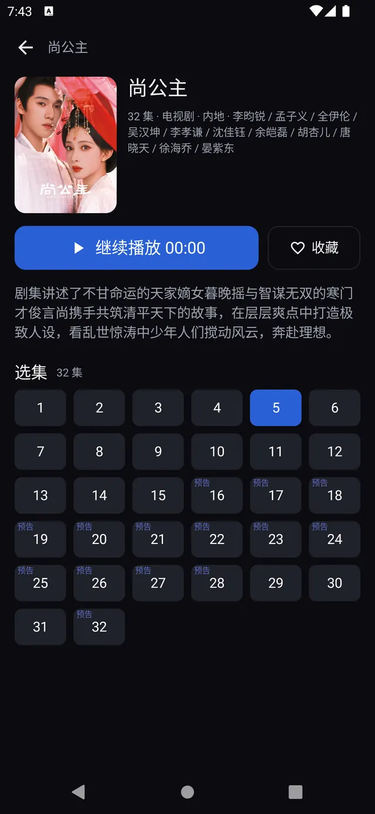
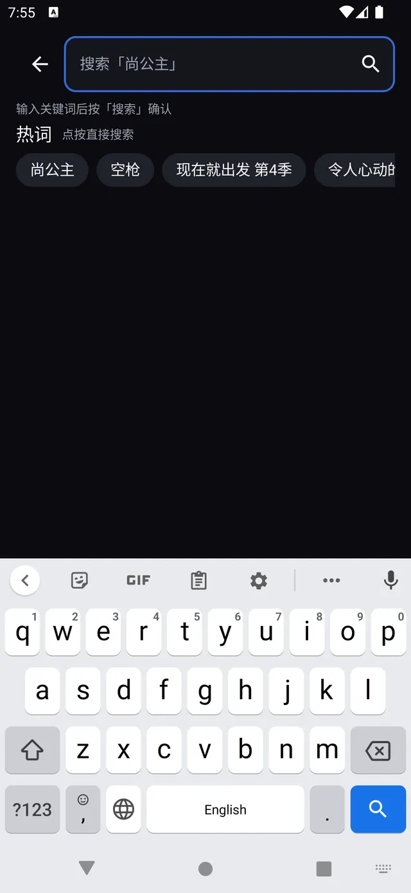
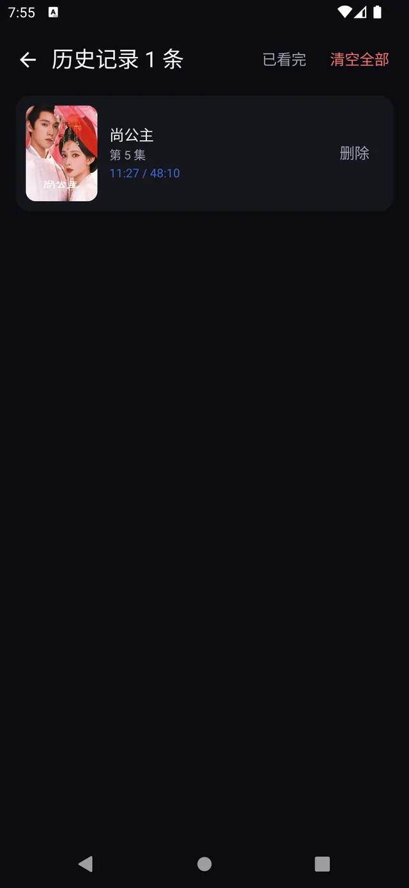

# ModaTv 手机端

腾讯视频聚合客户端的**手机版**：数据层与业务规则移植自 TV 端 [ModaTv](../ModaTv)，
交互层按触摸完全重写（TV 端那套遥控器焦点体系在手机端一行都没有）。

> 本项目是一个**非官方的第三方前端**，数据来自写死的后端代理接口与 v.qq.com 的公开页面。
> 仅用于学习与个人使用，请自行确认内容版权与所在地区法律法规。

---

## 界面

| 首页（19 分类，可横滑分页） | 详情（6 列选集 + 已看完/预告/VIP 角标） |
| --- | --- |
|  |  |

| 搜索（热词轮播） | 历史（条目进度条） |
| --- | --- |
|  |  |

截图取自 1440×3120 的 Pixel 类模拟器；播放页与设置页的截图随后续 UI 调整一并补。

---

## 与 TV 端的关系

| | TV 端 | 手机端 |
| --- | --- | --- |
| 输入 | 遥控器 D-Pad / 确认 / 返回 | 触摸：点击、滑动、双击、长按 |
| 导航 | 左侧栏 + 焦点体系 | **底部三项**（首页 / 收藏 / 设置）+ 压栈页 |
| 播放控制 | 九槽位自绘 OSD，左右键换值 | 顶栏（返回/标题·集号/投屏+锁定）+ 底栏两行（进度行 + 右下角簇）+ 手势 |
| 刷新 | 工具栏按钮 + 回首页 30 分钟门禁 | **双击底栏首页**是唯一入口；回首页**不**自动刷新；无下拉刷新 |
| 授权 | 屏幕出二维码，手机微信扫 | 二维码 + **一键拉起微信确认**（手机上自己扫不了自己屏幕） |
| 自更新 | `ModaTv<版本>.apk` + `version.json` | `ModaMobile<版本>.apk` + `version-mobile.json`（与 TV 隔离） |

数据层（`Api` / `Repo` / `Parser` / `CarouselSource` / `ChannelSource` / `data/local/*Store`）与 TV 端逐行同源，
错误码、存储域、片头片尾阈值、完成线（95%）全部一致——只有界面与交互不同。

## 功能

**首页**
- 19 个分类 tab（推荐 + 18 个频道），顶部可横滑；内容区是左右可滑的分页，与 tab 双向同步
- 推荐 tab 尾部接「继续观看」（最多 5 条，点卡片直接进播放页）
- 工具栏：品牌 + 两截时间（`上次刷新 … · 现在 …`）/ 搜索 / 历史（**没有刷新按钮**，刷新只走双击底栏首页）
- 卡片角标：**分类**（电视剧/电影/综艺…）+ **集数**（`全 N 集` / `更新至 N 集`）
- 缓存分层：每 tab 快照落盘，请求失败沿用过期的旧数据；进首页自动刷新只在**冷启动**判一次 30 分钟门禁

**搜索**
- 热词**两处轮播**：输入框占位符 3.5 秒换一个词（空输入点搜索就用它）、热词条每 4 秒自动前进一格并回卷
- 热词条在用户手动滑动/点击后暂停 8 秒；有搜索结果时不轮播
- 本地搜索历史（DataStore）

**详情**
- 竖版海报头图、可展开简介、主演/分类/集数
- 主按钮按历史显示「继续播放 mm:ss」或「播放」
- 选集是 **6 列密集网格**（40dp 格），当前集实心高亮、已看完绿勾、预告/VIP 角标；
  **点一集在本页换片源并自动开播**（不跳播放页，页面是否全屏由当前状态决定）
  有观看历史且续播集不在前 12 集时自动滚到该集
- 收藏 / 取消收藏

**播放器**
- 横屏全屏，Media3 ExoPlayer（默认，MP4 直链 → 起播失败切 HLS 兜底一次）+ IJK 软解，硬解/软解可切
- 手势：单击显隐控制层（3 秒自动隐藏）、**双击 = 播放/暂停**、横滑预览后松手 seek、
  纵滑**左半屏亮度 / 右半屏音量**（离开播放页自动还原亮度）；暂停后画面中央常驻一颗播放键
- 控制层：顶栏（返回 / 标题·集号 / 投屏 + 锁定）+ 底栏两行（播放/暂停 · 下一集 · 时间 · 进度 · 弹幕开关；
  右下角簇：倍速 / 码率 / 选集 / 更多）；「更多」里收弹幕面板 · 比例 · 播放内核 · 解码方式 · 片头片尾
- 锁定后不弹整个控制层：解锁键固定右侧竖排（44dp 圆钮，2.5 秒自收），锁定态仍可双击播放/暂停
- 七类功能面板统一版式；选集是贴右的卡片列表（16:9 缩略图 + 集号，当前集描边高亮）
- 换集 / 下一集 / 连播**原地换流**：旧画面留着只叠「切换中」，不再退回 Loading（避免横屏闪回竖屏）
- 弹幕（开关 / 字号 / 区域 / 上下边距）、倍速、画面比例、片头片尾自动跳过（间隔阈值与 TV 端一致）

**历史 / 已看完 / 收藏**
- 历史最多 60 条，条目带**播放进度条**，点进去直接续播
- 已看完按 `(cid, episodeIndex)` 记录，从历史页右上角进入
- 收藏是追剧语义，点条目进详情

**设置**
- 播放设置（内核 / 解码 / 默认倍速 / 弹幕默认开关）、网络与数据（清除各类本地数据与授权）、关于
- **分类排序**：自定义首页 19 个 tab 的顺序（推荐固定第一），排序完成回首页自动刷新一次
- 关于页：应用名 / 版本号 / 构建号 / 检查更新 / 版权声明

## 构建

```bash
# 需要 JDK 17 与 Android SDK 35（local.properties 里写 sdk.dir）
./gradlew assembleDebug
adb install -r app/build/outputs/apk/debug/app-debug.apk
```

- `minSdk 24` / `targetSdk 34` / `compileSdk 35`，Kotlin + Jetpack Compose（Material3），单模块 `:app`
- ABI 只保留 `arm64-v8a` + `armeabi-v7a`（IJK 的 ffmpeg 的代价）
- 没有单元测试：以 `assembleDebug` + 真机/模拟器手动走查作为验收手段

## 目录结构

```
app/src/main/java/com/moda/mobile/
├── ModaApp.kt                 # Application：注入 token / 设备指纹 / Auth
├── MainActivity.kt            # 单 Activity，edge-to-edge
├── data/                      # Api / Repo / Parser / 抓取源 / 更新 / local 各 Store
├── model/                     # VideoItem / SeriesDetail / Episode / AppError …
└── ui/
    ├── AppRoot.kt             # 底栏 + 压栈路由 + 授权门 + 各类弹窗
    ├── Destinations.kt        # 手写路由（不引 navigation-compose）
    ├── MainViewModel.kt       # 唯一状态中枢（屏幕层不碰网络）
    ├── *Screen.kt             # 首页 / 搜索 / 详情 / 历史 / 收藏 / 已看完 / 设置 / 授权门
    ├── components/            # 卡片、通用控件、RemoteImage（手搓图片加载）、错误文案
    └── player/                # PlayerEngine（双内核）/ 控制层 / 七个面板 / 弹幕层
```

## 已知限制

- **没有评分**：后端 `eps.meta` 与 `v.qq.com` 页面都不带评分，腾讯自己的 `float_vinfo2` 里 `douban` 字段实测恒为 0/null。
  首页卡片显示的是分类与集数角标。
- **自更新需要发布端配合**：仓库里没有 `version-mobile.json` 与 `ModaMobile<版本>.apk` 之前，检查更新会显示「已是最新」。
- 本地没有 `local.properties` 里的 `moda.keystoreFile` 时 `assembleRelease` 出的是未签名包
  （文件名仍是 `ModaMobile<版本>.apk`，装不上）；线上包由 CI 用仓库 Secrets 签名。
- 弹幕与分集缩略图依赖腾讯图床/接口，取不到时静默降级（不显示），不阻断播放。

## 相关文档

- [AGENTS.md](AGENTS.md)：本仓库的强制约定（分层、触摸纪律、导航规则、播放器、存储、文案、提交规范）
- [docs/PORT_CONTRACT.md](docs/PORT_CONTRACT.md)：手机端移植时的跨任务接口契约与文件归属

## 声明

本项目是免费软件，不出售、不收费、不提供任何形式的技术支持。
软件按「现状」提供，不作任何明示或暗示的担保；使用即表示已知悉并接受。